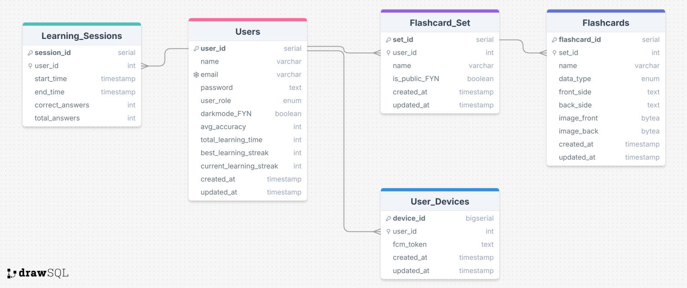

# StudyBro

StudyBro is a flashcard app for studying on a phone or tablet. You build sets of cards with text or an image on each side, flip through them in a learning mode and follow your statistics, and the cards stay available offline. This repository contains the Flutter app (`frontend/`) and the REST API behind it (`backend/`).

> **Status:** the backend used to run on Render. That deployment no longer works (it only answers with a database error), so the app cannot sign in or load data at the moment. To run everything yourself, see [Running it yourself](#running-it-yourself).

## What the app does

**Accounts.** You register with a name, email and password, log in, or continue as a guest. Passwords are hashed with bcrypt, and sessions use JWT tokens that last 24 hours (48 hours for guests). The splash screen checks the saved token and opens the start screen of the user's role: user, guest or admin.

**Sets and cards.** You create, rename and delete flashcard sets, and add, edit and delete the cards inside them. Each side of a card holds text or an image, taken with the camera or picked from the gallery.

**Learning.** You flip through the cards of a set. Every learning session of a signed-in user is saved on the server, and the statistics screen shows the average accuracy, the total study time, the best streak and the current streak. Statistics need a connection and can be reset in the settings.

**Public sets.** Admins create public sets in their admin panel, and guests can browse and study them. When an admin publishes a set, users who have the home screen open see a "New Public Set" message right away, delivered over Socket.IO.

**Offline use.** Sets and cards are cached on the device with Hive, so the cached sets still open without a connection.

**Reminders and monitoring.** A background task (Workmanager) shows a local notification that reminds you to study. The app asks for notification permission and sends its Firebase Cloud Messaging token to the backend, which stores it in the `User_Devices` table, but the backend does not send push messages itself. Firebase Analytics records a few events (`register_success`, `login_success`, `guest_login`, `learning_started` and `statistics_opened`), and Crashlytics reports app errors.

**Settings.** A dark mode switch and an "Improve readability" switch that enlarges the text. Both are remembered on the device.

**Phone and tablet.** Screens narrower than 600 pixels get the phone layout and wider ones the tablet layout. Every screen exists in both versions.

## How the parts fit together

The Flutter app runs on Android and talks to the Express API over HTTPS for all of its data, and it keeps a Socket.IO connection open to receive live events. The API checks a JWT on protected routes and keeps everything in PostgreSQL, including the card images. Firebase is used directly by the app for Cloud Messaging, Analytics and Crashlytics, while the backend only stores the device tokens.

## Technologies

| Part | Technologies |
|---|---|
| App | Flutter and Dart, Hive for the offline cache, `http` for the REST calls, Socket.IO client, Firebase (Core, Cloud Messaging, Analytics, Crashlytics), Workmanager and flutter_local_notifications, image_picker, connectivity_plus, shared_preferences |
| API | Node.js and Express, PostgreSQL through `pg`, bcrypt, jsonwebtoken, Socket.IO, Multer for image uploads, swagger-jsdoc and swagger-ui-express for the API docs, dotenv, cors |

## Database

The model has five tables: `Users` (account data, role and the dark mode flag), `Flashcard_Set` (a set that belongs to a user and can be public), `Flashcards` (the cards of a set, with text and optional images), `User_Devices` (the Firebase token of each device of a user) and `Learning_Sessions` (start and end time and the answers of every learning session, from which the statistics are calculated). Card images are stored as `bytea`.



The SQL that creates the tables is not part of this repository.

## API overview

All routes except `/`, registration, login, guest login and reading public sets need a Bearer token in the `Authorization` header. While the server runs, `/api-docs` serves interactive Swagger documentation. The same API is also published as an OpenAPI definition on [SwaggerHub](https://app.swaggerhub.com/apis/fiitstu-6d1/study-bro_api/1.0.1), with descriptions in Slovak, so it can be read without running anything.

| Area | Routes |
|---|---|
| Accounts | `POST /register`, `POST /login`, `POST /guest-login`, `GET /me`, `GET /verify-token` |
| Own sets | `GET` and `POST /flashcard-sets`, `GET`, `PUT` and `DELETE /flashcard-sets/:set_id` |
| Cards | `GET /flashcards/:set_id`, `GET /flashcard/:flashcard_id`, `POST /flashcards`, `PUT` and `DELETE /flashcards/:flashcard_id` |
| Public sets | `GET /public-sets`, `GET /public-flashcards/:set_id`, `POST /public-sets`, `POST /public-flashcards`, `DELETE /public-sets/:set_id`, `DELETE /public-flashcards/:flashcard_id` |
| Learning | `POST /learning-sessions`, `GET` and `PUT /statistics`, `POST /statistics/reset` |
| Other | `POST /notification-token`, `GET` and `POST /preferences` (the app does not call the preferences routes) |

Card images are uploaded as multipart fields `image_front` and `image_back`, kept in memory by Multer and then stored in PostgreSQL. They come back to the app as base64. Only admins can create public sets.

## Project layout

```
mobile-flashcard-app/
├── backend/                     Express REST API
│   ├── index.js                 routes, Swagger setup and server start
│   ├── queries.js               database access and the request handlers
│   ├── auth.js                  JWT check for protected routes
│   ├── socket.js                Socket.IO setup
│   └── .env.example             the settings the server reads
├── frontend/                    Flutter app
│   └── lib/
│       ├── Controllers/         pick the phone or tablet version of a screen by width
│       ├── Screens/             the screens, in Mobile/ and Tablet/ versions
│       ├── api_service.dart     all calls to the backend
│       ├── offline_models.dart  Hive models of the offline cache
│       ├── main.dart            app setup, theme, Firebase, background task
│       └── splash_screen.dart   token check and role based start screen
└── docs/
    └── database-model.png       logical model of the database
```

## Running it yourself

### Backend

You need Node.js (checked with version 24) and a PostgreSQL database that accepts SSL connections. The tables have to be created by hand, following the model above.

```bash
cd backend
npm install
```

Copy `.env.example` to `.env` and fill in the database connection and a long random `JWT_SECRET`. Then start the server:

```bash
npm start
```

It listens on `PORT` (3000 by default).

### App

The address of the backend is written into the code in three places: `baseUrl` in `frontend/lib/api_service.dart` and the Socket.IO connection in `frontend/lib/Screens/Mobile/home_screen_mobile.dart` and `frontend/lib/Screens/Tablet/home_screen_tablet.dart`. All three still point to the old Render address, so replace them with your own. The app expects HTTPS; plain HTTP needs cleartext traffic to be enabled in the Android manifest.

```bash
cd frontend
flutter pub get
flutter run
```

Run it on an Android device or emulator. It was checked with Flutter 3.29.2, and `flutter analyze` reports no errors. `pubspec.lock` pins the `workmanager` dependency, which comes from the main branch on GitHub, to a commit that works with that Flutter version, so avoid `flutter pub upgrade`. The Firebase configuration file `frontend/android/app/google-services.json` is not part of the repository, because it holds the API key of the original Firebase project. Copy `google-services.json.example` in the same folder to that name and fill in the values from your own Firebase project.

## Team

Built by **Alexej Putiška** and **Roman Skurák**.
